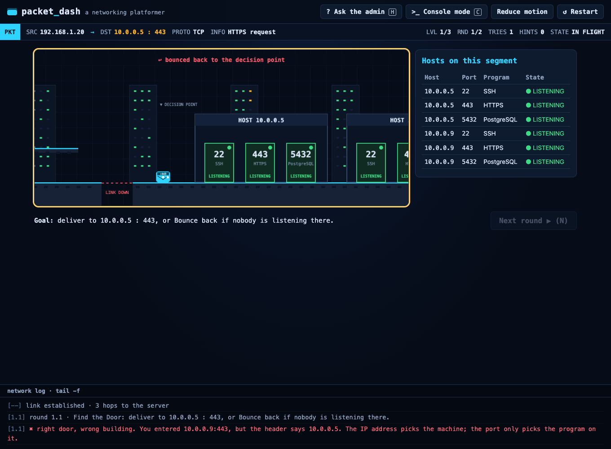

# Packet Dash

**Run and jump as a data packet across the network, and learn ports, latency vs bandwidth and lost-packet resends by making delivery decisions.**

Packet Dash is a browser platformer for software engineers and other technical people who use networks every day but have never studied networking. You play **Pak**, a small packet travelling from a laptop to a server. At the end of each stretch you make one delivery decision: which door, which path, which pieces to resend. The level then plays out the consequence and explains it. After each level, a **"From the news"** card connects the idea to the FAA ground stop and the Chase outage of November 2026.

A project from **NAF AC6 — Loop Engineering, Spec-Driven Development & the Future of VibeOps**.

| Project | Details |
| --- | --- |
| Status | Playable and verified locally (see [Verification](#verification)) |
| Networking topic | IPv4 addresses and TCP ports; latency vs bandwidth; sequence numbers and selective resend. A simplified teaching model |
| Typical session | 5–10 minutes, 3 levels × 2 rounds |
| Live demo | Not published yet |
| Built by | ad46009, with Claude Code |



## The challenge

Pak's header reads `DST 10.0.0.5 : 443`. Two server buildings, 10.0.0.5 and 10.0.0.9, each have doors 22 (SSH), 443 (HTTPS) and 5432 (PostgreSQL), with a LISTENING or CLOSED light. You run along the cable trays, jump the "LINK DOWN" gaps and enter a door. Pick 443 on 10.0.0.9 and you bounce back with `✖ right door, wrong building … The IP address picks the machine; the port only picks the program on it.` Enter 443 on 10.0.0.5 and the log prints `✔ delivered 10.0.0.5:443 → HTTPS`, then the Laptop → Router link lights up on the network map.

## What you'll learn

| By the end, you can… | You'll practice by… |
| --- | --- |
| Tell what an IP address picks (the machine) from what a port picks (the program), and recognise "connection refused" | Entering the right building and door, or Bounce back when nobody is listening |
| Predict whether a short narrow path or a long wide path delivers sooner | Choosing the Copper Tunnel or the Fibre Trunk for a 10 KB and a 1000 KB packet |
| Identify exactly which numbered pieces are missing, whatever order the rest arrived in | Marking pieces for resend on the receiver board, then pressing SEND |

**Before playing:** no networking knowledge needed. Each level's briefing teaches the idea with an analogy and a worked example.

## Play locally

Needs Python 3.11+ and a desktop browser. No install, build step or API key.

```sh
python3 start.py
```

This serves the folder at **http://127.0.0.1:8000** and opens your browser. If 8000 is busy it picks the next free port and prints the URL. Stop it with **Ctrl+C**. Without the launcher:

```sh
python3 -m http.server 8000 --bind 127.0.0.1     # Windows: py -m http.server 8000 --bind 127.0.0.1
```

Opening `index.html` straight from disk (`file://`) won't work, because JavaScript modules and JSON have to be served over HTTP.

## How to play

1. Play the **link test**: a short practice stretch where floating keys show you each control right where you need it (run → jump the gap → enter door 7 on 127.0.0.1 → ask the admin). Each step ticks off as you do it. You can skip it.
2. Read the network map and the level briefing.
3. Run to the decision point. Pak shows the header value it has to match in a thought bubble, and the first round of each level shows floating keys for that level's new action.
4. Enter a door, a path or the SEND flag. Entering is your answer; walking past isn't.
5. Read the **network log**. A wrong answer bounces you back to the decision point to try again; a correct one enables **Next**.
6. Deliver all six rounds to light every link and reach the delivery report.

| Control | Action |
| --- | --- |
| ← → (or A D) | Run |
| Space (or W) | Jump |
| ↑ or E | Enter a door or path; mark or unmark a piece; press SEND |
| N | Next round, once delivered |
| H / **Ask the admin** | First press explains the method; second shows the worked solution. Both are recorded as hints |
| C / **Console mode** | Swap the platforming for a list of the same choices as buttons and checkboxes. No jumping or timing needed |
| **Reduce motion** | Stops the blinking and replay animations (it also follows your OS setting) |
| **Restart** | Asks for confirmation, then clears the session. Cancel keeps your progress |

**Progress:** a round completes only on a correct answer. Each answered door, path or SEND counts as one attempt; an empty SEND gives guidance without counting. Falling into a gap just respawns you, with no lives, score or timer. Progress lives in the page, so reloading starts fresh.

## What this game models

A simplified teaching model of one IPv4 packet and one TCP-style connection on one one-way trip.

- **Level 1:** the destination IP address selects the machine, and the port selects the program listening on it. A packet never switches to another door. When nothing is listening, the server replies with a reset, which apps report as "connection refused".
- **Level 2:** delivery time = travel time + size ÷ bandwidth. The smaller total wins.
- **Level 3:** pieces carry sequence numbers. The receiver sorts by number and reports what it holds, and the sender resends only the missing numbers.

**Outside the model:** handshakes, routing, DNS, firewalls, NAT, congestion, queueing, TCP windows, round trips, header sizes and real timing.

| Reference | What it supports |
| --- | --- |
| [IANA Service Name and Port Number Registry](https://www.iana.org/assignments/service-names-port-numbers) | 22 = SSH, 443 = HTTPS, 5432 = PostgreSQL |
| [RFC 9293 §3.5.2 Reset Generation](https://www.rfc-editor.org/rfc/rfc9293#section-3.5.2) | A segment for a connection that doesn't exist gets a reset |
| [RFC 9293 §3.4 Sequence Numbers](https://www.rfc-editor.org/rfc/rfc9293#section-3.4) | Data is numbered so the receiver can order it and detect gaps |
| [RFC 2018 §3, §5](https://www.rfc-editor.org/rfc/rfc2018) | The receiver reports the blocks it holds; unacknowledged data is what gets retransmitted |
| Kurose & Ross, *Computer Networking*, §1.4 | Propagation + transmission delay; queueing and processing are excluded here |

### The November 2026 outages

| After | Event | How it connects |
| --- | --- | --- |
| Level 1 | **FAA nationwide ground stop, Nov 13.** Officials said a newly installed router sent "more than 1,000 connection attempts every four to five seconds" into the FAA network ([Scripps News](https://www.scrippsnews.com/life/travel/what-caused-the-faa-ground-stop-officials-point-to-router-failure)) | Every connection attempt is a packet knocking on an address and a port |
| Level 2 | **The same event's copper-to-fibre upgrade**, the maintenance under way when the router was installed | Fibre is the wide trunk. Bandwidth helps, but it isn't the whole story, and changes carry risk |
| Level 3 | **Chase transaction slowdown, Nov 16.** Chase cited "a software bug in an on-premise hardware system", not cyber-related; other banks were slowed when they were party to a transaction with Chase ([Al Jazeera](https://www.aljazeera.com/news/2026/11/17/us-bank-outage-what-caused-chase-problems-and-zelle-payment-delays)) | A transaction, like a message, is only finished when the other side confirms it |

The cards quote what was reported as of Nov 17, 2026, with source links, and say that investigations may change the details. The game doesn't claim to reconstruct either incident.

## How it was built

The project follows the workshop's Spec Kit workflow: **constitution → specify → clarify → plan → tasks → analyze → implement**.

- **Stack:** HTML, CSS and native JavaScript modules; one 2D `<canvas>` for the platformer, drawn in code. No libraries.
- **Build tools:** Claude Code (Opus 5.5) as the coding agent, GitHub Spec Kit 1.4.2.dev0 (Claude integration), Node 22 for tests, headless Chrome for the automated playtest.
- **Runtime:** static files served locally. No model, API key or network access while playing.
- **Planning inputs:** `StarterKit/CONSTITUTION.md`, `StarterKit/SPEC.md`, `StarterKit/PLAN.md`.
- **Working artifacts:** `.specify/memory/constitution.md` and `specs/001-packet-dash/` (`spec.md`, `plan.md`, `tasks.md`, `analysis.md`, `verification.md`).
- **One useful design decision:** analysis flagged that the 1.1 spec had no Bounce back pad, so "bounce when someone is listening" couldn't be tested. The pad now appears in both Level 1 rounds, and the mistake gets its own explanation.

Code layout: `engine/` holds the pure rules, content validation, session state and feedback; `render/` the world layout and canvas game; `ui/` the screens and panels; `data/levels.json` all rounds, hints, feedback wording, sources and news cards.

## Verification

**Last checked:** 2026-11-17, macOS 26 (Darwin 25.3), Chrome headless via puppeteer-core 23.11.1, Node 22.21.1. Details in [`specs/001-packet-dash/verification.md`](specs/001-packet-dash/verification.md).

```sh
npm test                    # or: node --test tests/*.test.js
```

The browser runner is at **http://127.0.0.1:8000/tests/** while the server runs.

| Check | Result | Evidence / notes |
| --- | --- | --- |
| Correct, incorrect and boundary cases | Pass | 46/46 Node tests. Covers every spec case, including the 100 KB tie being rejected, plus link-test step order |
| Briefings and explanations checked against sources | Pass (author review) | RFC 9293 §3.4/§3.5.2 and RFC 2018 §3/§5 wording confirmed against rfc-editor.org; news cards checked against the linked articles on 2026-11-17. Not yet reviewed by a second person |
| Retry, hint, duplicate submit, completion, restart | Pass | Automated state tests, plus a Chrome check: wrong answer → attempt 1, cancelled restart keeps progress, confirmed restart returns to the map |
| Keyboard-only core playthrough | Pass (automated) | Headless Chrome completed the link test and all six rounds with key presses only, platform mode for 1.1–3.1 and Console mode for 3.2. No console errors. A human keyboard-only run hasn't been recorded yet |
| Narrow layout and reduced motion | Pass | 390 px wide: no horizontal scroll. The OS reduced-motion setting turns on reduced mode |
| Fresh checkout run instructions | Pass | `python3 start.py --no-open --port 8765` served the game used in all checks above |
| Screen reader | Not run | A live region and text equivalents are in place but haven't been tested with VoiceOver or NVDA |

## Known limitations and next steps

- **Known limitation:** at phone width the canvas gets small; Console mode is the better way to play there.
- **Known limitation:** the canvas is decorative for assistive technology. All decision values are repeated in DOM text (header bar, hosts and paths tables, receiver board, Console mode).
- **Next improvement:** a fourth level on retries and timeouts, showing how a flood of reconnect attempts (like the FAA router) can crowd out real traffic.

Found an incorrect answer or unclear explanation? Open an issue with the level/round, input values, your choice, the expected result, the actual result and a reference if you have one.

## Credits

Created by ad46009 with Claude Code. Workshop by John Capobianco, Joksan Flores and Elliot Conner. Adapted from the [NAF AC6 workshop materials](https://github.com/automateyournetwork/NAF_AC6) and [Networking Video Game Starter Kit](https://github.com/automateyournetwork/NetworkingVideoGameStarterKit), using [GitHub Spec Kit](https://github.com/github/spec-kit).

**Assets and dependencies:** all visuals are original and drawn in code, with no image, font or audio assets and no runtime dependencies. News cards quote and link to the published reporting they cite.

**License:** Apache License 2.0, see [LICENSE](LICENSE).
